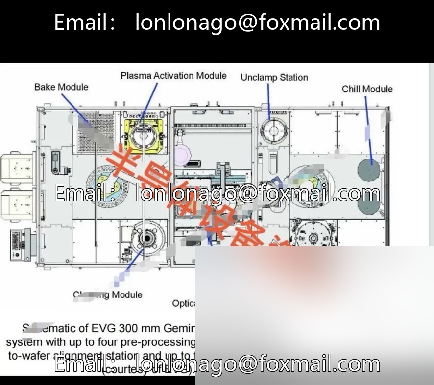
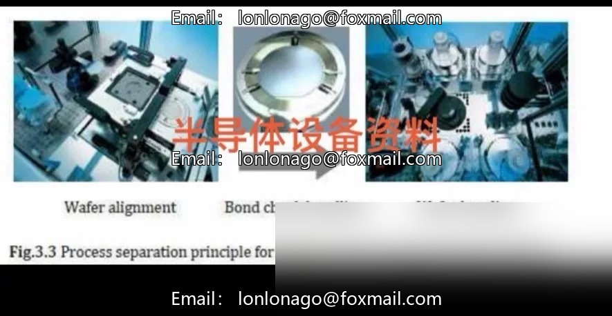
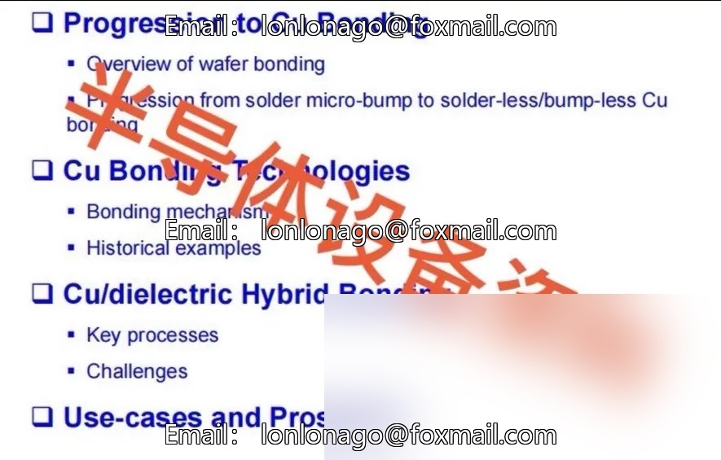
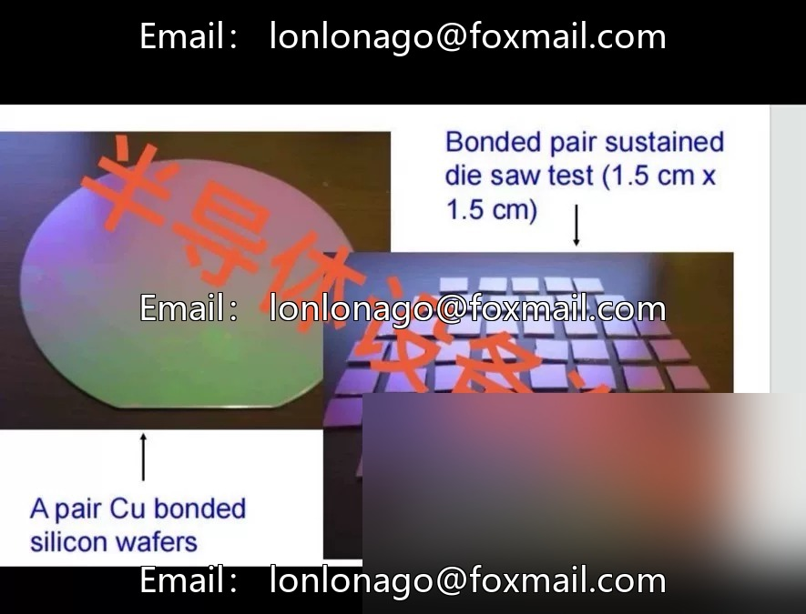
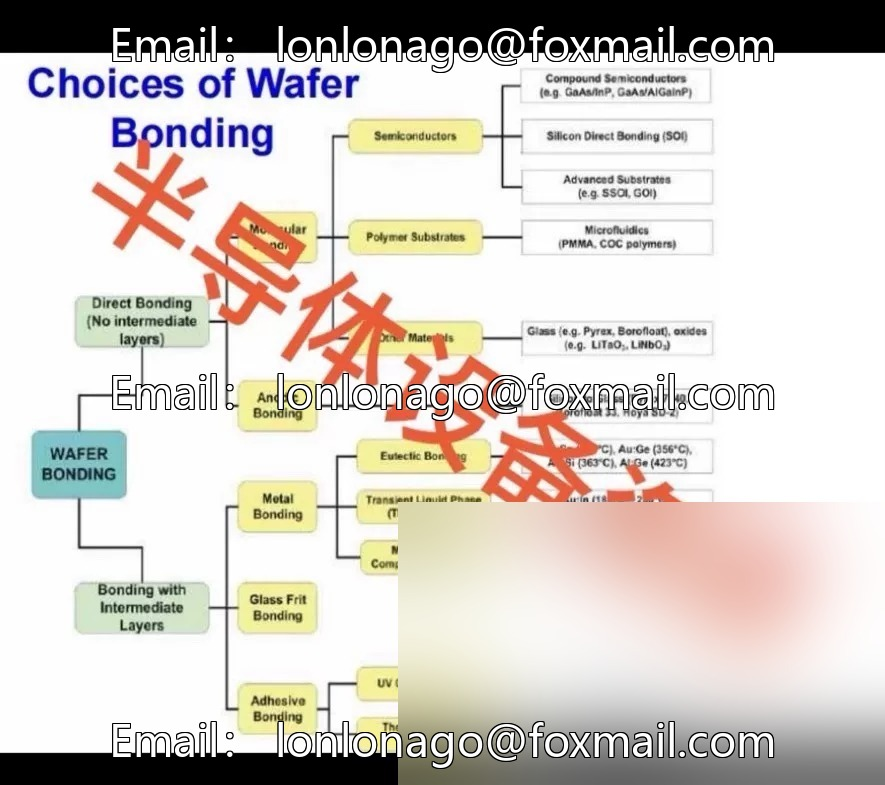

# D2W Hybrid Bonding Technology Materials: The content mainly discusses the application of copper bonding technology! A total of 85.

## Body

D2W Hybrid Bonding Technology Document: The content mainly introduces copper bonding technology applications! It consists of 85 pages of material based on the EVG300 hybrid bonding equipment! First launch material!

Capture and send the electronic original directly! The following images include screenshots of the file portion. Please confirm before placing the order! Due to the replicable nature of electronic documentation Therefore, are allowed after purchase! Thanks for understanding!

For personal learning and reference use only.

The material covers copper bonding applications in mixed bonding technology, totaling 85 pages; it is based on EVG300 mixed bonding equipment and offers electronic originals. It includes Plasma Activation Module, Unclamp Station, Bake Module, Chill Module, ig Module, Optici, semiconductor device details, wafer alignment, bond cr, Fig.3.3 Process separation principle for, Progression to Cu Bonding, Cverview of wafer bonding, bonding mechanisms, historical examples, Cu/dielectric HybridD~n, Key processes, Challenges, Use-cases and Pros, and related topics such as bonded pairs, die saw test, silicon wafers, compound semiconductors, and bonding in semiconductors.

<!-- AI_ENRICHED -->

## Images

## Payment

Here is a pay link on Stripe ( https://buy.stripe.com/3cs8yP7sY87d0vu9AB ). Please contact me lonlonago@foxmail.com after funding $89, and I will send you a complete data files , thank you!

